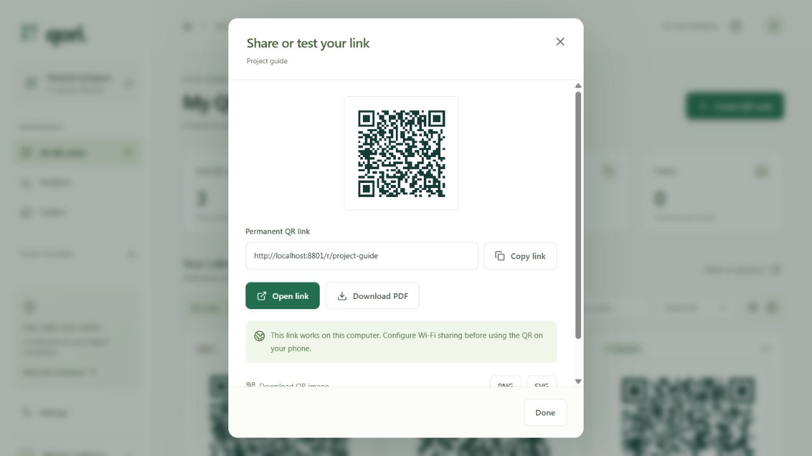
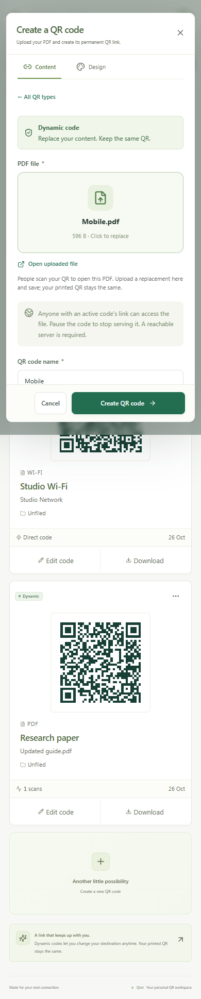

# Qori test and improvement review

Reviewed on **26 October 2026**. Scope: desktop and 390 px mobile layouts; login; QR creation and editing; all 19 content encoders; PDF upload/replacement and downloads; folders; analytics; sharing; recovery and Wi-Fi configuration.

**Result:** the checked flows pass. The running local app has been updated with the improvements below. Tests used disposable databases and an in-memory preview workspace, separate from personal records.

## Improvements made

| Priority | Finding | Implemented improvement |
|---|---|---|
| High | A missing value could previously leave the signed-in app blank. | ESLint now checks undefined references before every build. A tested recovery screen handles unexpected rendering failures and offers reload. |
| Medium | The PDF upload control was pushed below unnecessary disabled type choices; its placeholder asked for a destination. | Upload comes first, the fixed mode is a compact note, and the preview explicitly asks for a PDF. Save is unavailable until a file has uploaded. |
| Medium | Testing a QR or copying a phone-friendly URL required several disconnected actions. | A **Share or test link** dialog shows the complete URL, Open link, Copy link, PNG/SVG downloads, and a direct Download PDF option. |
| Medium | Secure clipboard APIs may be absent on plain HTTP Wi-Fi addresses. | Copy now falls back to the browser's local copy action, then selectable text if needed. The fallback was exercised in browser tests. |
| Medium | Mobile cards, labels, and controls were compressed; notifications could overlap editor actions. | Phone cards use one column with larger text and controls. Opening a dialog clears an old notification. |
| Medium | Switching networks could leave QR codes pointing at an old Wi-Fi IP. | The app detects a stale configured LAN address and shows a warning. The sharing utility can rebase loopback addresses and this app's previous LAN origin after taking a full database backup. |
| Low | Small uploads displayed as 0.00 MB and long filenames could make an invalid default QR name. | Sizes use bytes/KB/MB as appropriate. Generated names are capped at the editor's supported length. |

## Reviewed flow

1. Choose PDF from the searchable content-type gallery.
2. Upload the document, review its name and QR design, and save. Preview copy clearly explains that the code must be saved before scanning.
3. Open **Share or test link** to test the redirect, copy the complete address, or download the PDF/QR.
4. Edit the saved code and replace its PDF. The encoded QR address remains unchanged.

The screenshots below show generic test records, not personal files.

## Verification

- **14 backend test groups passed**, including every content type's exported PNG decoding, logo PNG/SVG decoding, static immutability, dynamic editing, upload validation, file access and replacement, byte ranges, authentication, origin checks, persistence, password recovery, routing, and stale Wi-Fi address detection.
- **5 browser scenarios passed**: four complete flows plus a focused stale-network warning check. These cover onboarding/login/logout; dashboard search/filter/list views; folders; analytics; QR design and downloads; PDF upload/replacement/pause/resume; mobile upload layout; long filenames; copying without the secure clipboard API; an actual PDF download; keyboard interaction; and recovery after a deliberately malformed test response.
- ESLint and the production build passed. Builds now require the code check to pass.
- Dependency installation/audit reported **0 known vulnerabilities**.
- The live desktop page and its current script loaded successfully. The current hotspot address responded, and HEAD checks verified four active dynamic redirects and two served PDFs without increasing scan totals.

## Limits and remaining operational considerations

- The final address is the phone-hotspot address **http://10.177.121.108:8787**. During the review, the computer briefly joined another router and returned to the hotspot. No QR addresses were rewritten to the temporary router address.
- Keep the computer awake and Qori running. A downloaded QR cannot change its encoded IP when the computer joins another network. Update Wi-Fi sharing and download affected QR images again after an address change, or keep a stable local address.
- Mobile checks used browser viewport emulation. This review did not remotely control the physical phone. The user had previously confirmed that its PDF link opens/downloads on the phone.
- Keyboard and visible layout checks do not constitute a full screen-reader or WCAG compliance audit.
- Docker and an external HTTPS deployment were not executed in this environment. The Docker build inputs were updated for the new code-check step.
